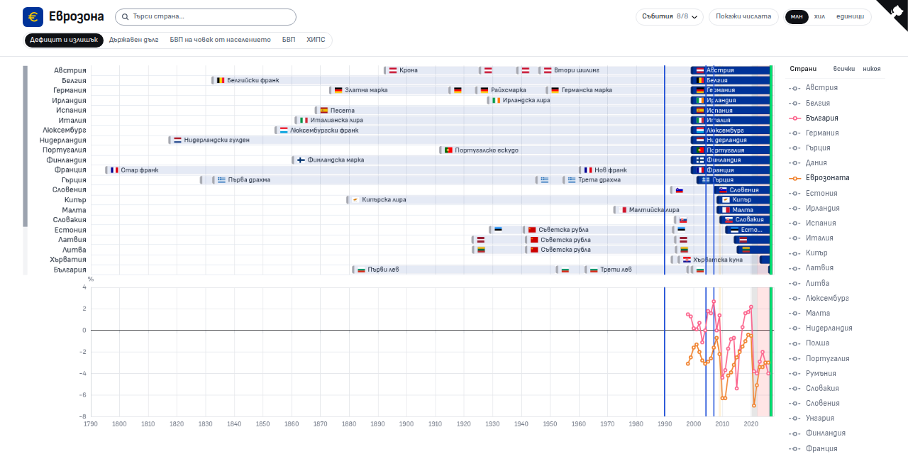

# Еврозона

Сайт за това кога страните от ЕС приеха еврото. Валутите на 27-те държави са наредени по години, редом с дефицита, дълга, БВП и инфлацията им.

Сайтът е на адрес <https://vibe-nation.github.io/the-eurozone/>.

[](https://vibe-nation.github.io/the-eurozone/)

## Какво показва графиката

- **Валутите по държави:** валутите на 27-те държави от ЕС през годините и кога страните от еврозоната преминават към еврото.
- **Данни от Евростат:** дефицит и излишък (като % от БВП и в евро), държавен дълг, БВП и хармонизиран индекс на потребителските цени (ХИПЦ).
- **Събития:** периоди и дати, които се отбелязват върху цялата графика и се включват и изключват от менюто „Събития“.

Държавите се избират от списъка до графиката или с търсачката. При клик върху период се отваря панел с датите и продължителността му и с валутите на страната.

## Стартиране

```bash
npm install
npm start
```

След това сайтът се отваря на `http://localhost:4200/`.

## Команди

| Команда         | Какво прави                                              |
| --------------- | -------------------------------------------------------- |
| `npm start`     | Пуска сървър за разработка с презареждане при промяна.   |
| `npm run build` | Прави продукционна версия в `dist/the-eurozone/browser`. |

При публикуване в GitHub Pages сайтът получава базов адрес `/the-eurozone/`, защото е в подпапка. Затова адресите в приложението трябва да остават относителни.

## Структура

| Път                    | Съдържание                                                                           |
| ---------------------- | ------------------------------------------------------------------------------------ |
| `src/app/index`        | Страницата с графиката, търсачката, менюто със събития и страничния панел.           |
| `src/app/services`     | Зареждането на данните и изграждането на графиката.                                  |
| `public/data`          | Данните на графиката: валути, серии и събития. Описани са в своя `README.md`.        |
| `public/data/eurostat` | Суровите файлове от Евростат, от които идват сериите. Описани са в своя `README.md`. |
| `public/flags`         | Знамената на държавите.                                                              |
| `.claude/skills`       | Умението за Claude Code, с което се добавят и обновяват показателите.                |

## Добавяне на показател

Сериите в `public/data/charts.json` се генерират от суровите файлове на Евростат и файлът не се редактира на ръка. Показателите се добавят с Claude Code. Отворете го в папката на проекта и опишете какво искате. Подходящото умение се включва само, а можете да го извикате и по име:

- `/eurostat-extract` добавя или обновява показател от Евростат на графиката, винаги за всички години.

Умението е в `.claude/skills/eurostat-extract/`, а форматът на данните е описан в [`public/data/README.md`](public/data/README.md).
